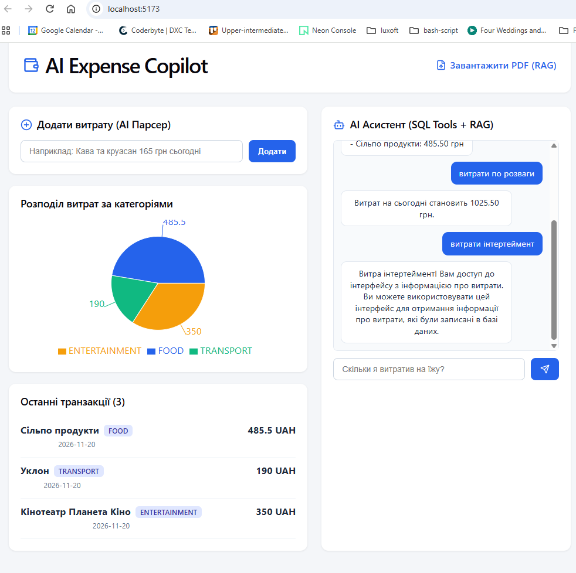

# AI Financial & Expense Copilot

An end-to-end Full-Stack & AI personal finance assistant built with **React (TypeScript)** and **Java 21 (Spring Boot & Spring AI)**. It transforms unstructured expense notes into structured database records, visualizes spending analytics, and answers natural language queries using **LLM Tool Calling** and **RAG (Retrieval-Augmented Generation)**.

## Key Features
* **AI Expense Parser (Structured Outputs):** Converts raw text (e.g., *"Silpo groceries 485 UAH today"*) into strictly typed Java records and persists them in PostgreSQL.
* **Conversational Financial Agent (`@Tool` Calling):** The LLM dynamically invokes Java repository methods to calculate real-time spending metrics without hallucinating numbers.
* **Document Q&A (RAG with `pgvector`):** Upload PDF financial documents or bank terms; text is chunked, embedded via Ollama (`mxbai-embed-large`), and queried via cosine similarity search.
* **Real-Time Streaming UI (SSE):** Token-by-token response streaming from Spring WebFlux (`Flux<String>`) to React via Server-Sent Events.
* **Interactive Analytics:** Real-time category breakdown rendered with **Recharts**.

## Tech Stack
* **Frontend:** React 19, TypeScript, Vite, Recharts, Lucide Icons, Server-Sent Events (SSE).
* **Backend:** Java 21 (Virtual Threads), Spring Boot 3+, Spring AI, Spring Data JPA, Flyway Migrations, JUnit 5 & Mockito.
* **Database & AI:** PostgreSQL 16 + `pgvector`, Ollama (`llama3.2` & `mxbai-embed-large`), Docker.

## Architecture Flow
1. **Ingestion:** User enters raw text -> Spring AI enforces JSON schema via `.entity(ParsedExpenseDto.class)` -> Saved to PostgreSQL.
2. **RAG Pipeline:** User uploads PDF -> `PagePdfDocumentReader` + `TokenTextSplitter` -> Vector embeddings stored in `pgvector`.
3. **Chat & Streaming:** User asks a question -> Spring AI fetches top-K relevant PDF chunks + exposes `@Tool` functions -> Streams response tokens via SSE to React.

## Getting Started

### Prerequisites
* Java 21+, Node.js 20+, Docker Desktop, and [Ollama](https://ollama.com) (`ollama pull llama3.2` & `ollama pull mxbai-embed-large`).

### 1. Start PostgreSQL with `pgvector`
```bash
docker compose up -d
```

### 2. Run the Java Backend
```bash
cd backend
./mvnw spring-boot:run
```

### 3. Run the React Frontend
```bash
cd frontend
npm install
npm run dev
```
Open `http://localhost:5173` in your browser.


